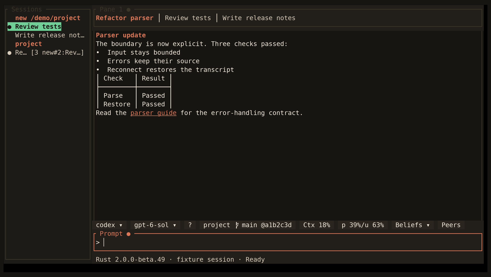

<p align="center"></p>

<p align="center">
  <a href="https://github.com/docwilde/doxa/releases/latest"></a>
  <a href="https://github.com/docwilde/doxa/actions/workflows/rust-ci.yml"></a>
  
</p>

**DOXA** is a Rust terminal workspace for coding agents. Run Claude, Codex, DeepSeek, or GLM in tabs and split panes, then close the terminal and reattach to running sessions later. [Jev](docs/jev-router.md) routes each turn among configured models and can independently supervise fleet alignment at host checkpoints. Integrated [LORE](https://github.com/docwilde/LORE) shares reviewed memory across DOXA, Claude Code, and Codex.

> [!WARNING]
> Rust 2.0 is in beta. Agents can edit files and run commands with your privileges. Choose a [session isolation profile](docs/session-isolation.md) and review the [platform limits](#platform-and-scope) before using DOXA on important work.

[How the gallery was captured](docs/rust-gallery.md)

## Contents

- [Install and start](#install-and-start)
- [Workspace and sessions](#workspace-and-sessions)
- [Engines and review](#engines-and-review)
- [Remote access](#remote-access)
- [Gallery](#gallery)
- [Platform and scope](#platform-and-scope)
- [Documentation](#documentation)

## Install and start

Install the [latest Rust beta release](https://github.com/docwilde/doxa/releases/latest):

```sh
curl -fsSL https://raw.githubusercontent.com/docwilde/doxa/main/scripts/install.sh | sh
```

The installer builds the frontend, daemon, remote adapter, isolation and plugin workers, and native LORE carrier, then puts `doxa` in `~/.local/bin` by default. It adds a Linux application-menu entry or a macOS `~/Applications/DOXA.command` shortcut. Set `DOXA_NO_LAUNCHER=1` to skip the shortcut. Run `doxa update` to update; pass a tag after `sh -s --` to select a version. The installer builds source and does not authenticate a release signature or attestation; `DOXA_RUST_EXPECTED_SHA` can require an independently obtained 40-character commit SHA before it builds.

```sh
doxa doctor --engine codex
doxa new --engine codex
doxa list
```

Choose an installed engine in place of `codex`. Claude needs its CLI; protected Codex needs its private provider build on Linux. DeepSeek and GLM need API credentials through `/setup` or environment variables. `doxa help` lists CLI commands. From a checkout, use `./task build`, `./task run`, or `./task install`.

## Workspace and sessions

- **Work in parallel.** Open tabs with Ctrl+T, split with Alt+V or Alt+H, and keep a prompt in each pane. The project rail groups live and recoverable sessions. Saved layouts restore on launch.
- **Detach and return.** Ctrl+W closes a tab while its daemon runs; Ctrl+Q exits the window and leaves sessions detached. `/resume` finds saved sessions, including closed tabs. Ctrl+X stops the active daemon and retains its transcript.
- **Review the work.** Expand reasoning and tool calls, inspect diffs and worktrees, and use the action palette or slash commands. The Peers chip opens the active session's peer map, and restored peer receipts retain sender provenance. Context values survive session restore only as a clearly marked **Last reported** snapshot; reported context categories and subscription quota bars appear only when providers supply them. Select transcript text and press Ctrl+C to copy through a supported desktop helper, with OSC52 as a terminal-dependent fallback; Ctrl+V pastes into the prompt draft that started the read. LORE facts, beliefs, and pending proposals have TUI review controls; verified pending proposals affect local rail urgency. Project headings can use a verified-root hue and an explicit `/collection project-label`; `/collection view panes` groups live tabs by pane and names a hidden tab needing attention. Bounded local Markdown images and opt-in Mermaid previews appear in the transcript; Mermaid PNGs use a private session cache. `/codegraph` opens bounded Rust and Python syntax queries and reviewed LORE snapshots with source and complete-scan freshness checks, without writing to LORE.
- **Choose isolation.** Start in `native`, `docker-open`, or `docker-offline`. Linux Docker profiles use a private rootless worker and checkout, with effective cgroup memory, CPU, PID, and swap limits checked before admission and CLI provider turns. The isolation chip shows the verified policy. Change an idle session with `/isolation PROFILE --confirm`. [Setup and limits](docs/session-isolation.md).

The [Rust guide](rust/README.md) covers keys, session recovery, worktrees, settings, and review behavior.

## Engines and review

| Engine | Connection | Setup |
| --- | --- | --- |
| Claude | Claude Code CLI | Sign in with the CLI. |
| Codex | Protected private app server | Linux build and Codex sign-in. |
| DeepSeek | Rust API client | Supply an API key. |
| GLM | Rust API client | Supply a z.ai API key. |
| Jev Router (opt-in) | Jev selects configured DeepSeek/GLM API or authenticated Claude/Codex CLI targets | Private candidate config, worker credentials and `TYPESAFE_API_KEY`. |

[Engine capability matrix](docs/engine-capabilities.md) lists model, permission, cost, compaction, and platform support. The picker distinguishes sourced model facts from unknown context or thinking support. API budget admission uses a conservative documented price bound and refuses an unknown priced bound.
The [Jev Router](docs/jev-router.md) keeps one canonical conversation while selecting an eligible configured worker at each turn. `/model auto` enables routing; a target ID pins it. Native Claude and protected Codex workers retain their tool and permission reviews. Their account charges remain unknown and are excluded from the tracked Jev/API allowance.

Enable it in **`/settings` → Session → default engine → Jev Router**. Set the private candidate-config path, press **Ctrl+P** to review current authentication and catalogs, then **Ctrl+S** to save the default for new sessions. Selecting a fixed engine disables that default. New Session also offers the reviewed Router targets in its clickable model dropdown. [Settings walkthrough](docs/router-settings.md).
`doxa model-facts ENGINE MODEL [--review-before YYYY-MM-DD]` prints exact sourced facts and flags operator-selected review candidates. Add `--check-catalog` for an explicit read-only OpenAI API listing check with `OPENAI_API_KEY`; it reports listed, unlisted, or unknown without changing model or budget admission.

Fleets can run an acting coordinator and workers under a reviewed charter, typed host gates, and spending limits. A separately selected alignment supervisor, including pinned **Jev 1.13.0**, evaluates fleet scope and host evidence; a distinct fast LLM or Jev message judge reviews peer messages. Neither reviewer inherits worker authority or history. Dependent Docker-isolated workers wait for a host checkpoint, receiver read-back, sender agreement, and explicit human release; later turns and handoffs invalidate the review. `/fleet dependency-review` shows the evidence in the TUI. An owner-reviewed offline recipe can produce snapshot-bound test receipts; opt-in `--auto-test` runs it after host-observed turns. Receipts do not release dependencies. `doxa fleet debrief RUN --root PATH` summarizes bounded host evidence after a run without opening peer bodies or making model calls. A private scorer can evaluate consented, labeled real-message verdicts; no such corpus ships and evaluation does not change enforcement. [Fleet supervision](docs/fleet-supervision.md).

## Remote access

Remote control is opt in. `doxa remote serve` exposes a private Rust browser view through Tailscale Serve. A private `doxa-hub` lets another DOXA installation use browser, CLI, or native TUI control across machines. Native clients can encrypt transcript and control content end to end with a shared key; the hub still sees connection metadata. `doxa remote tui HUB_URL --save-layout` saves remote-only tabs; `/remote-control HUB_URL --save-layout` opts in to mixed local/remote pane restore after fresh roster checks. The [remote guide](rust/README.md#remote-access) covers setup and limits. The [Chrome extension](browser-extension/README.md) supports encrypted hub sessions. The [Android client](android-client/README.md) has local and opt-in FCM background alert paths. Its debug APK builds and opens in an offline emulator; provisioned FCM, device and tailnet checks remain open.

See the [browser and Android gallery](docs/remote-gallery.md) for client screenshots and capture details.

## Search and MCP

Open **`/settings` → `0 MCP`** to save Tavily, Firecrawl, Exa and Brave Search
API keys in the masked private editors. Select an owner-private server config,
then **Ctrl+P** checks configured servers without calling tools. MCP is opt-in
for DeepSeek, GLM and Router API workers. [Configuration and templates](docs/mcp-client.md),
[tool review and accounting](docs/vendor-mcp.md).

Use **`/setup docker`** for rootless Docker prerequisites and reviewed worker
image/socket configuration. [Docker setup](containers/session/README.md).
GLM exposes an owner-declared API bundle profile and a separate optional quota
monitor; cash balance and bundle remainder remain unknown.
[GLM account reporting](docs/glm-account-reporting.md).

## Gallery

These beta.49 screenshots capture the production Ratatui app in a real GTK/VTE terminal, using illustrative session data. The [capture record](docs/rust-gallery.md) explains each scene and how to reproduce it. Browser and Android screenshots have their [own gallery](docs/remote-gallery.md).

<!-- gallery-carousel:start -->
**Workspace** — Three engine tabs, a project rail, and a Markdown turn in the production Ratatui app.

[](assets/shots/rust-2.0.0-beta.49-hero.png)

[← Code graph](docs/gallery/scenes/codegraph.md) · [Next: Jev Router settings →](docs/gallery/scenes/settings-router.md)
<!-- gallery-carousel:end -->

The [interactive gallery](https://docwilde.github.io/doxa/gallery/) has keyboard and on-page previous/next controls. GitHub's README view shows one static frame above; each [one-frame Markdown page](docs/gallery/scenes/settings-router.md) also has previous and next links.

## Platform and scope

Linux has bounded live checks for all four engines. macOS has build and transport CI, but authenticated provider sessions still need live verification; protected Codex is Linux only. Windows is unsupported. See [platform verification](docs/platform-verification.md). Python 1.x is archived at [v1.19.0](https://github.com/docwilde/doxa/tree/v1.19.0); its [manual](docs/manual.md) is historical.

DOXA loads selected provider plugins with scoped adoption rules. Remote access needs explicit private network setup. The [parity tracker](docs/rust-1.19-parity.md) and [latest provider verification](docs/live-provider-verification-2026-10-04.md) record detailed evidence and open checks.

## Documentation

- [Rust guide](rust/README.md) — install, sessions, review, fleets, and remote use.
- [Engine capabilities](docs/engine-capabilities.md) — what each provider supports.
- [Jev router](docs/jev-router.md) — candidate configuration, automatic routing, pins, budgets and evaluation limits.
- [Release publication](docs/releasing.md) — advertise the current recommended beta as GitHub Latest.
- [Session isolation](docs/session-isolation.md) — Docker profiles and their limits; guarded egress checks kernel writers and connector scope through each upload chunk, but the checks are sequential and exact Engine/container identity and provider flows remain unproved. The [quota helper](docs/hard-quota-preflight.md) is inactive; hardened admission stays closed.
- [Fleet supervision](docs/fleet-supervision.md) — independent review and message judging.
- [Code graph queries](docs/plans/code-graph.md) — bounded Rust and Python syntax queries with source-read deadlines; a blocked reader can linger until process exit. The [disabled semantic probe](docs/plans/codegraph-semantic-verification.md) repeats a bounded whole-worktree observation around one inspect/attach/LSP exchange, but the mutable reads are non-atomic and `binding=unknown`; [scan benchmark](docs/codegraph-scan-benchmark-2026-10-09.md).
- [Native plugins](docs/native-plugins.md) — owner-approved text commands, status files and read-only host checks. The Linux runner rechecks opened worker and Bubblewrap identity before exec and rejects writable delegated cgroup components. The nine-case installed-host proof remains unrun and TUI authority closed.
- [Plans and open work](docs/plans/README.md) — current implementation status.

DOXA is licensed under [AGPL-3.0-only](LICENSE), with a [commercial licence](LICENSE-COMMERCIAL.md) available. The name and mark follow the [trademark policy](TRADEMARK.md).
