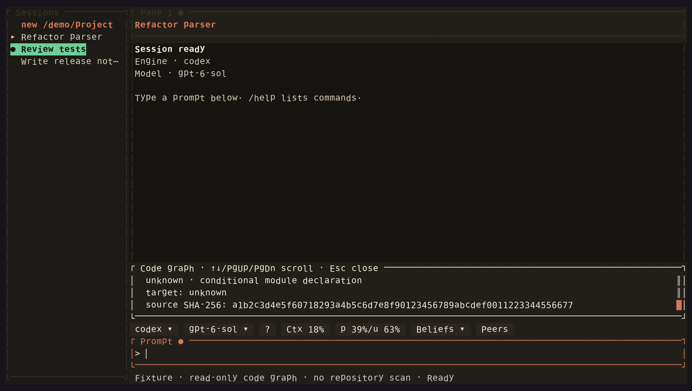

<!-- Generated by scripts/generate_gallery_pages.py from scenes.json. -->
# Code graph

[← Thinking](./reasoning.md) · [Next: Workspace →](./hero.md)

**Scene 28 of 28**

A synthetic read-only module query shows source freshness evidence and an unknown conditional edge.

[Open the interactive gallery](https://docwilde.github.io/doxa/gallery/#codegraph) · [Back to the README gallery](../../../README.md#gallery)
