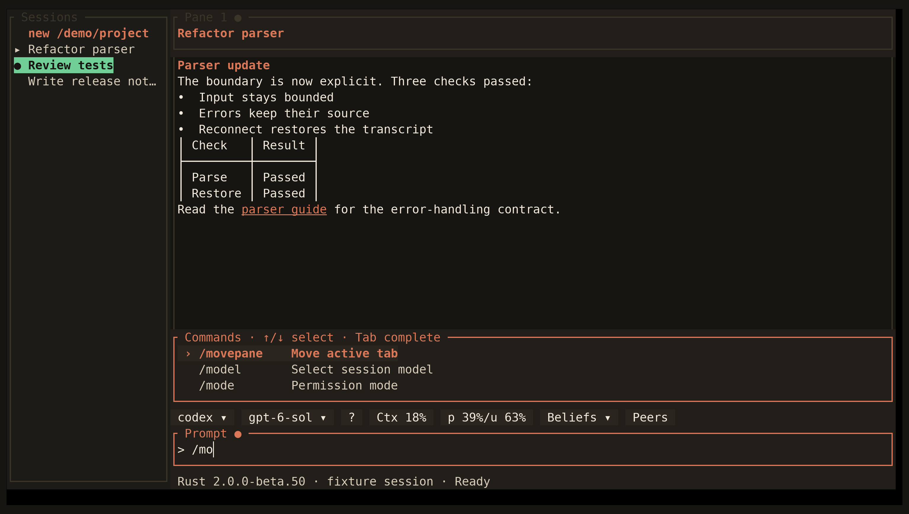

<!-- Generated by scripts/generate_gallery_pages.py from scenes.json. -->
# Commands

[← Memory](./memory-management.md) · [Next: Help →](./help.md)

**Scene 25 of 28**

Slash-command completion appears in the prompt.

[Open the interactive gallery](https://docwilde.github.io/doxa/gallery/#commands) · [Back to the README gallery](../../../README.md#gallery)
