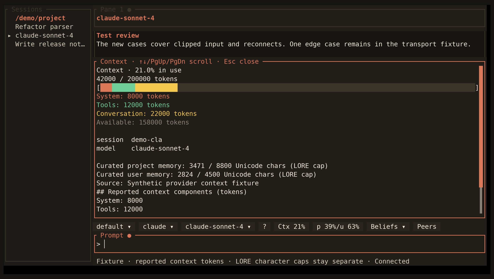

<!-- Generated by scripts/generate_gallery_pages.py from scenes.json. -->
# Context usage

[← Fleet status](./fleet-view.md) · [Next: Subscription quota →](./usage-quota.md)

**Scene 8 of 28**

Synthetic provider totals and reported categories are shown separately from LORE memory character caps.

[Open the interactive gallery](https://docwilde.github.io/doxa/gallery/#context) · [Back to the README gallery](../../../README.md#gallery)
