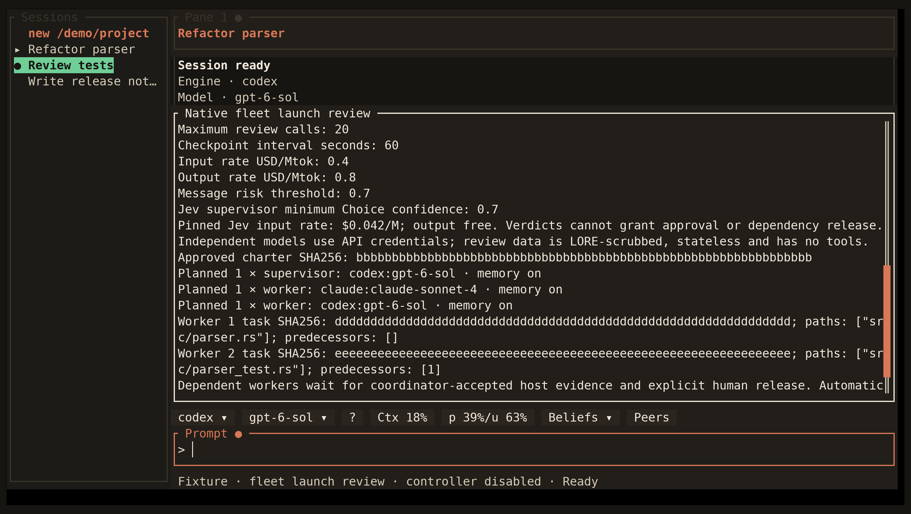

<!-- Generated by scripts/generate_gallery_pages.py from scenes.json. -->
# Dependency plan

[← Fleet review](./fleet-review.md) · [Next: Dependency release review →](./fleet-release-review.md)

**Scene 5 of 28**

A synthetic fleet plan shows a dependency edge and explicit human release requirement.

[Open the interactive gallery](https://docwilde.github.io/doxa/gallery/#fleet-dependency) · [Back to the README gallery](../../../README.md#gallery)
