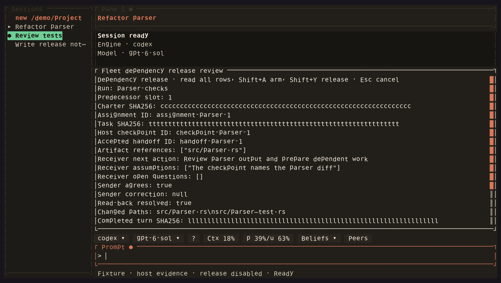

<!-- Generated by scripts/generate_gallery_pages.py from scenes.json. -->
# Dependency release review

[← Dependency plan](./fleet-dependency.md) · [Next: Fleet status →](./fleet-view.md)

**Scene 6 of 28**

Synthetic checkpoint and handoff evidence appear in the production review modal; release is disabled.

[Open the interactive gallery](https://docwilde.github.io/doxa/gallery/#fleet-release-review) · [Back to the README gallery](../../../README.md#gallery)
