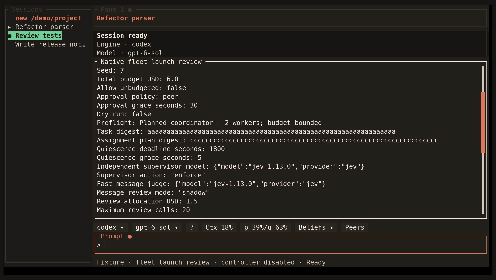

<!-- Generated by scripts/generate_gallery_pages.py from scenes.json. -->
# Fleet review

[← Routing status](./routing-status.md) · [Next: Dependency plan →](./fleet-dependency.md)

**Scene 4 of 28**

A synthetic launch review shows the acting coordinator, independent alignment supervisor, message judge, and bounded review budget. Launch is disabled.

[Open the interactive gallery](https://docwilde.github.io/doxa/gallery/#fleet-review) · [Back to the README gallery](../../../README.md#gallery)
