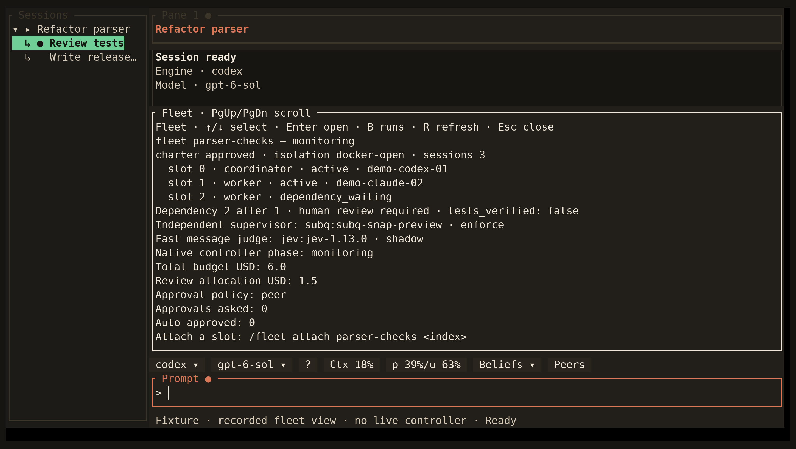

<!-- Generated by scripts/generate_gallery_pages.py from scenes.json. -->
# Fleet status

[← Dependency release review](./fleet-release-review.md) · [Next: Context usage →](./context.md)

**Scene 7 of 28**

Review fleet status with workers grouped beneath their supervisor

[Open the interactive gallery](https://docwilde.github.io/doxa/gallery/#fleet-view) · [Back to the README gallery](../../../README.md#gallery)
