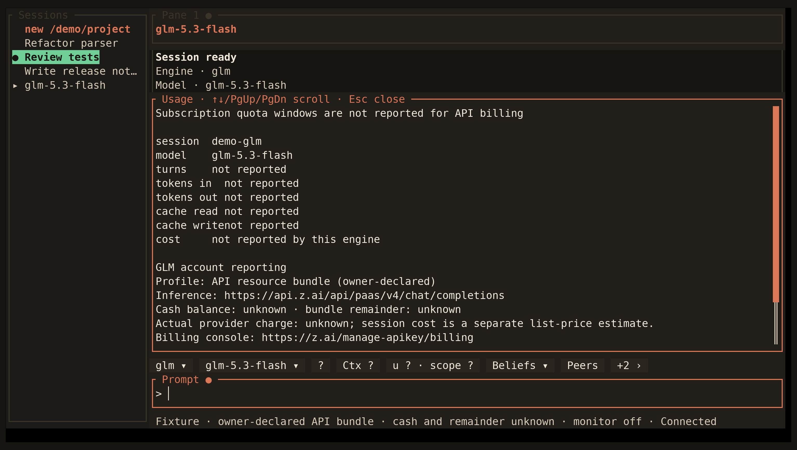

<!-- Generated by scripts/generate_gallery_pages.py from scenes.json. -->
# GLM reporting

[← MCP and search settings](./settings-mcp.md) · [Next: Docker setup →](./setup-docker.md)

**Scene 15 of 28**

The owner-declared API bundle is shown while unknown cash balance and remaining allowance stay unknown.

[Open the interactive gallery](https://docwilde.github.io/doxa/gallery/#glm-account) · [Back to the README gallery](../../../README.md#gallery)
