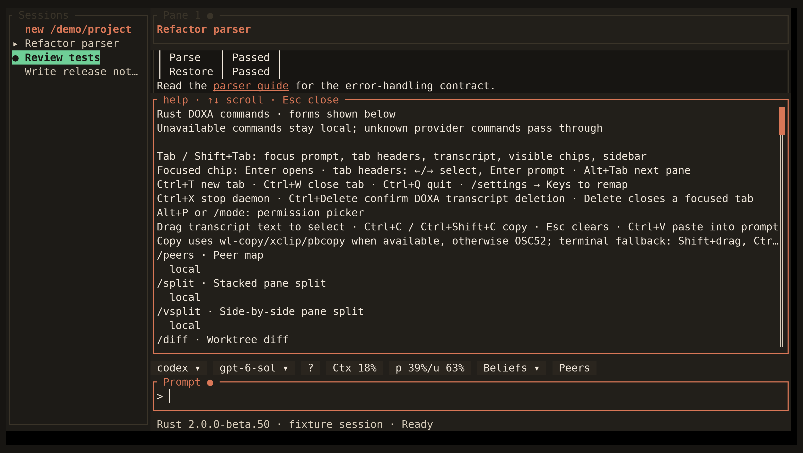

<!-- Generated by scripts/generate_gallery_pages.py from scenes.json. -->
# Help

[← Commands](./commands.md) · [Next: Thinking →](./reasoning.md)

**Scene 26 of 28**

Built-in command help is open in the workspace.

[Open the interactive gallery](https://docwilde.github.io/doxa/gallery/#help) · [Back to the README gallery](../../../README.md#gallery)
