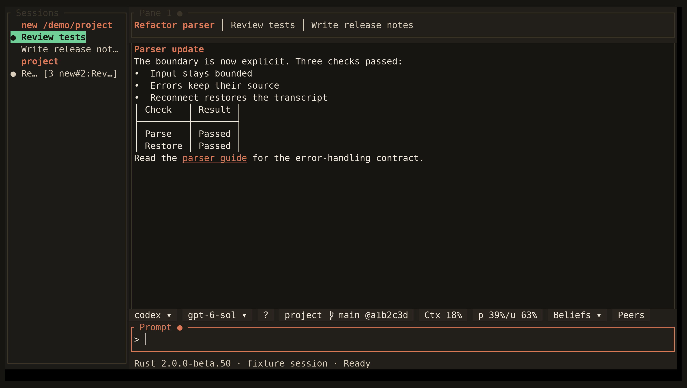

<!-- Generated by scripts/generate_gallery_pages.py from scenes.json. -->
# Workspace

[← Code graph](./codegraph.md) · [Next: Model Router settings →](./settings-router.md)

**Scene 1 of 28**

Three engine tabs, a project rail, and a Markdown turn in the production Ratatui app.

[Open the interactive gallery](https://docwilde.github.io/doxa/gallery/#hero) · [Back to the README gallery](../../../README.md#gallery)
