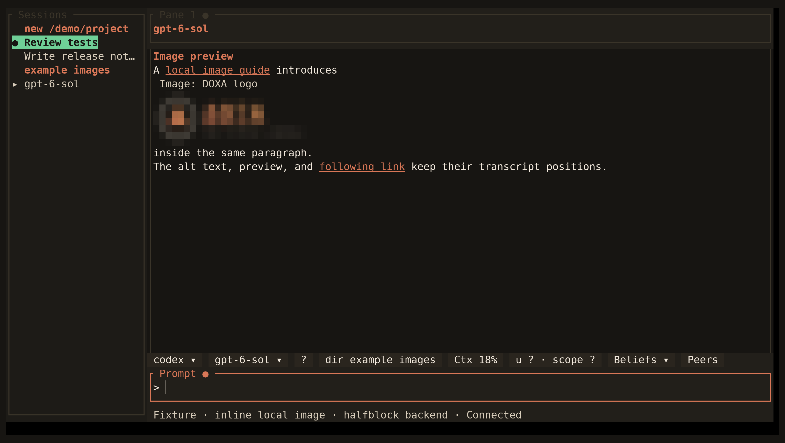

<!-- Generated by scripts/generate_gallery_pages.py from scenes.json. -->
# Image preview

[← Project label](./project-label.md) · [Next: Session isolation →](./isolation.md)

**Scene 20 of 28**

A local Markdown image appears inline in the transcript using the halfblock fallback.

[Open the interactive gallery](https://docwilde.github.io/doxa/gallery/#image-preview) · [Back to the README gallery](../../../README.md#gallery)
