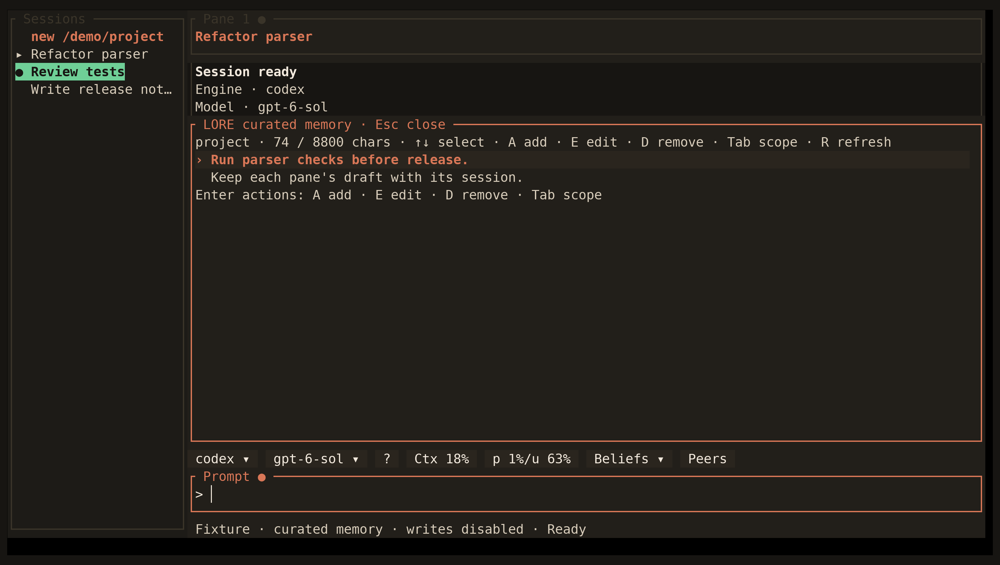

<!-- Generated by scripts/generate_gallery_pages.py from scenes.json. -->
# Memory

[← Tool details](./tool-entries.md) · [Next: Commands →](./commands.md)

**Scene 24 of 28**

Curated project-memory controls are shown with writes disabled.

[Open the interactive gallery](https://docwilde.github.io/doxa/gallery/#memory-management) · [Back to the README gallery](../../../README.md#gallery)
