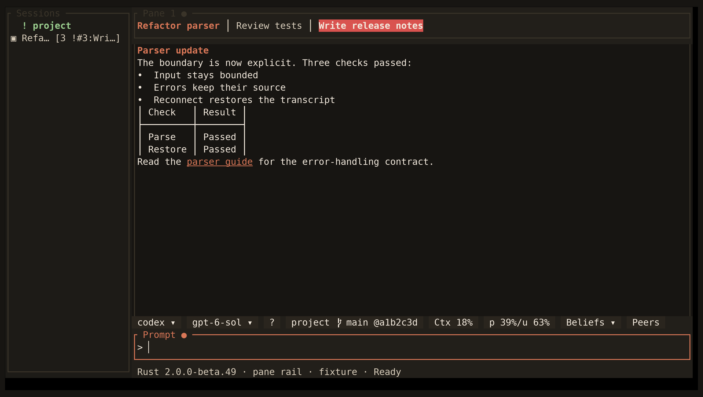

<!-- Generated by scripts/generate_gallery_pages.py from scenes.json. -->
# Pane rail

[← Project triage](./triage.md) · [Next: Project label →](./project-label.md)

**Scene 18 of 28**

Grouped panes stay navigable while hidden-tab urgency remains visible.

[Open the interactive gallery](https://docwilde.github.io/doxa/gallery/#pane-triage) · [Back to the README gallery](../../../README.md#gallery)
