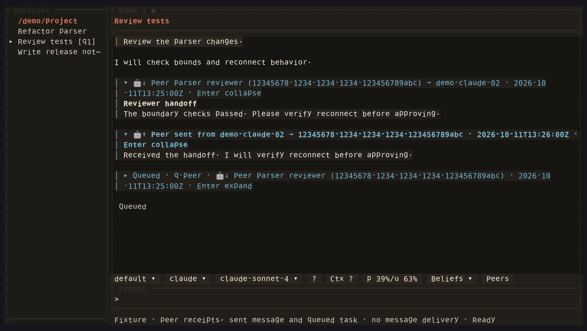

<!-- Generated by scripts/generate_gallery_pages.py from scenes.json. -->
# Peer details

[← Peer messages](./peer-messages.md) · [Next: Queued prompts →](./queued-prompts.md)

**Scene 11 of 28**

The fixture expands received and sent messages with their session addresses and direction markers.

[Open the interactive gallery](https://docwilde.github.io/doxa/gallery/#peer-expanded) · [Back to the README gallery](../../../README.md#gallery)
