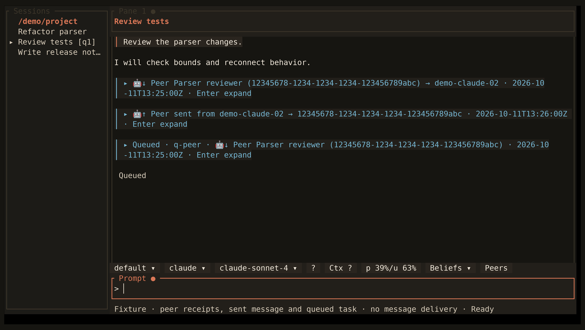

<!-- Generated by scripts/generate_gallery_pages.py from scenes.json. -->
# Peer messages

[← Subscription quota](./usage-quota.md) · [Next: Peer details →](./peer-expanded.md)

**Scene 10 of 28**

Received, sent, and queued peer activity appears with direction markers while message bodies stay collapsed by default.

[Open the interactive gallery](https://docwilde.github.io/doxa/gallery/#peer-messages) · [Back to the README gallery](../../../README.md#gallery)
