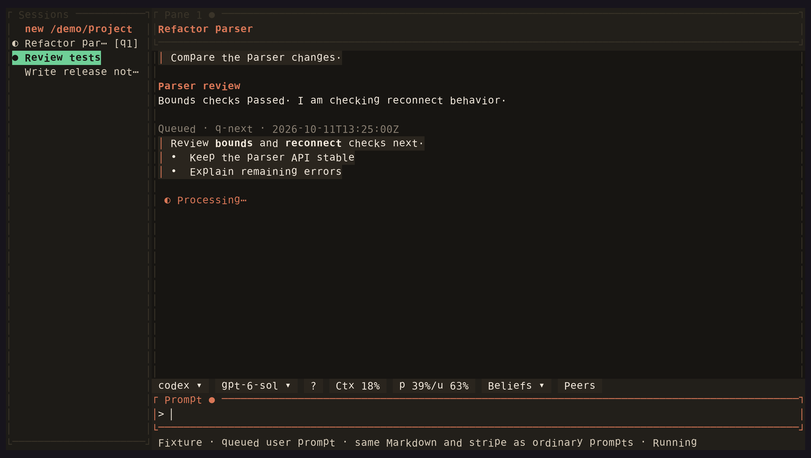

<!-- Generated by scripts/generate_gallery_pages.py from scenes.json. -->
# Queued prompts

[← Peer details](./peer-expanded.md) · [Next: Settings →](./settings.md)

**Scene 12 of 28**

A queued user prompt keeps its Markdown and user stripe while another turn is running.

[Open the interactive gallery](https://docwilde.github.io/doxa/gallery/#queued-prompts) · [Back to the README gallery](../../../README.md#gallery)
