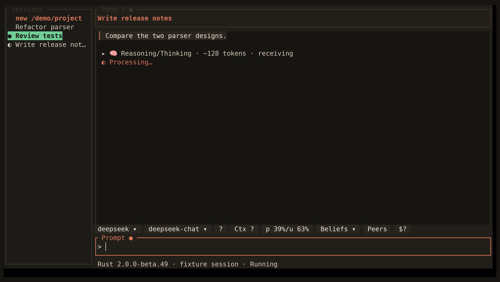

<!-- Generated by scripts/generate_gallery_pages.py from scenes.json. -->
# Thinking

[← Help](./help.md) · [Next: Code graph →](./codegraph.md)

**Scene 27 of 28**

A collapsed reasoning-progress section shows a synthetic token count.

[Open the interactive gallery](https://docwilde.github.io/doxa/gallery/#reasoning) · [Back to the README gallery](../../../README.md#gallery)
