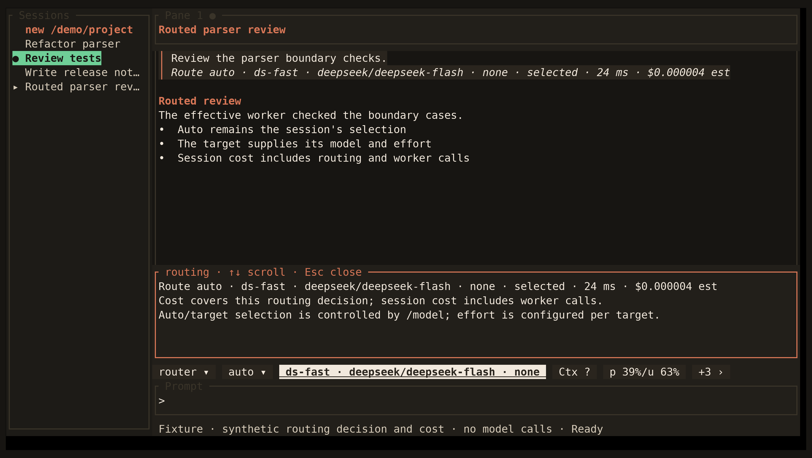

<!-- Generated by scripts/generate_gallery_pages.py from scenes.json. -->
# Routing status

[← Model Router settings](./settings-router.md) · [Next: Fleet review →](./fleet-review.md)

**Scene 3 of 28**

A synthetic Auto decision shows the selected worker separately from decision/API routing cost. No provider call is made.

[Open the interactive gallery](https://docwilde.github.io/doxa/gallery/#routing-status) · [Back to the README gallery](../../../README.md#gallery)
