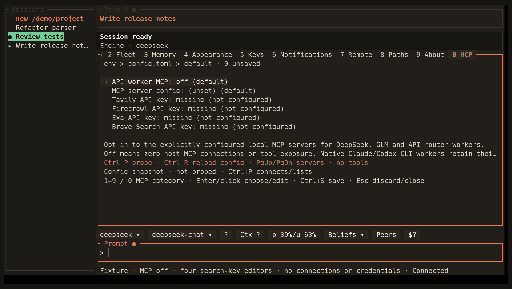

<!-- Generated by scripts/generate_gallery_pages.py from scenes.json. -->
# MCP and search settings

[← Settings](./settings.md) · [Next: GLM reporting →](./glm-account.md)

**Scene 14 of 28**

API worker MCP controls and masked search-key fields are shown without connections or tool calls.

[Open the interactive gallery](https://docwilde.github.io/doxa/gallery/#settings-mcp) · [Back to the README gallery](../../../README.md#gallery)
