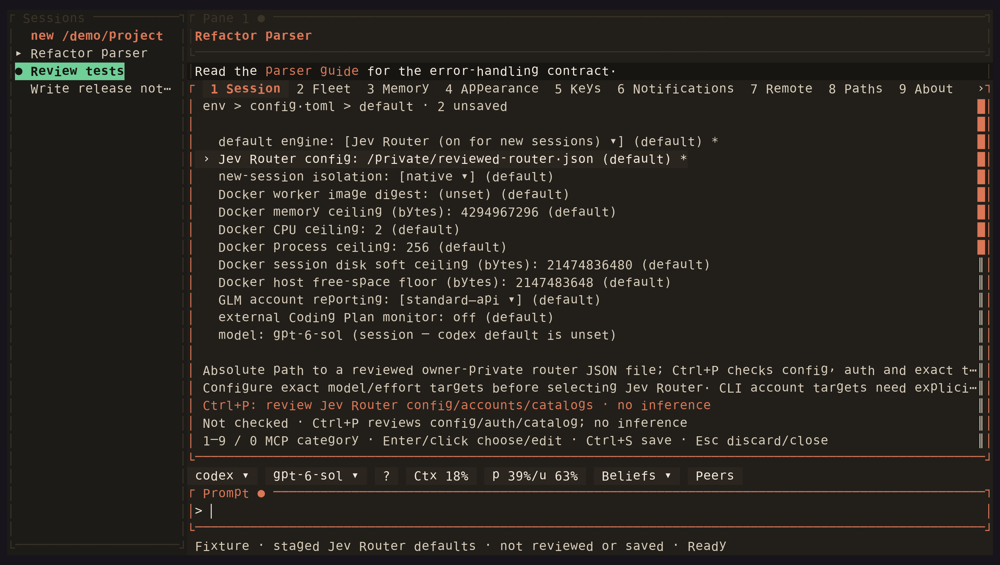

<!-- Generated by scripts/generate_gallery_pages.py from scenes.json. -->
# Jev Router settings

[← Workspace](./hero.md) · [Next: Routing status →](./routing-status.md)

**Scene 2 of 28**

Router defaults are staged for review; the private config has not been checked or saved.

[Open the interactive gallery](https://docwilde.github.io/doxa/gallery/#settings-router) · [Back to the README gallery](../../../README.md#gallery)
