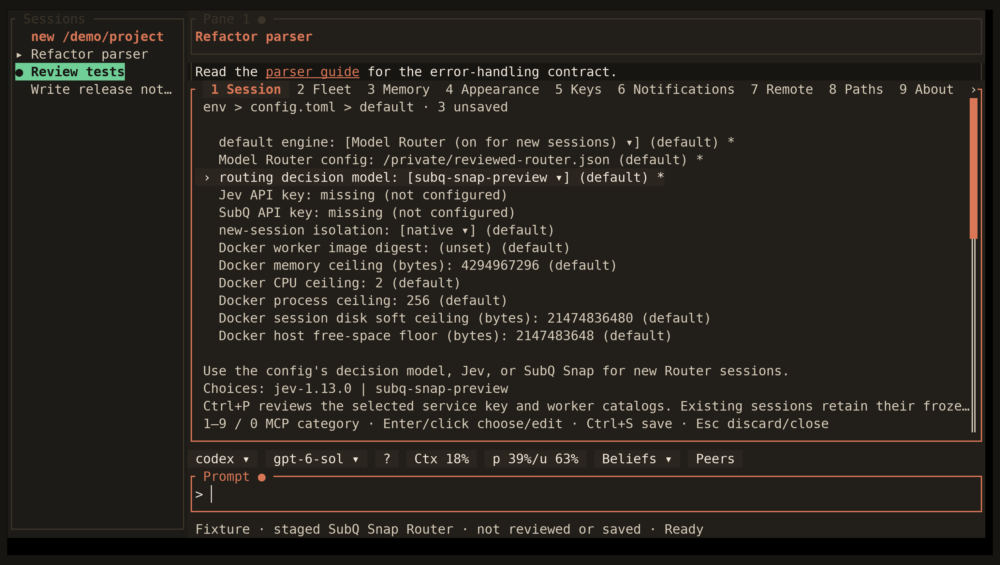

<!-- Generated by scripts/generate_gallery_pages.py from scenes.json. -->
# Model Router settings

[← Workspace](./hero.md) · [Next: Routing status →](./routing-status.md)

**Scene 2 of 28**

Configure Jev or SubQ Snap routing in the native Settings menu

[Open the interactive gallery](https://docwilde.github.io/doxa/gallery/#settings-router) · [Back to the README gallery](../../../README.md#gallery)
