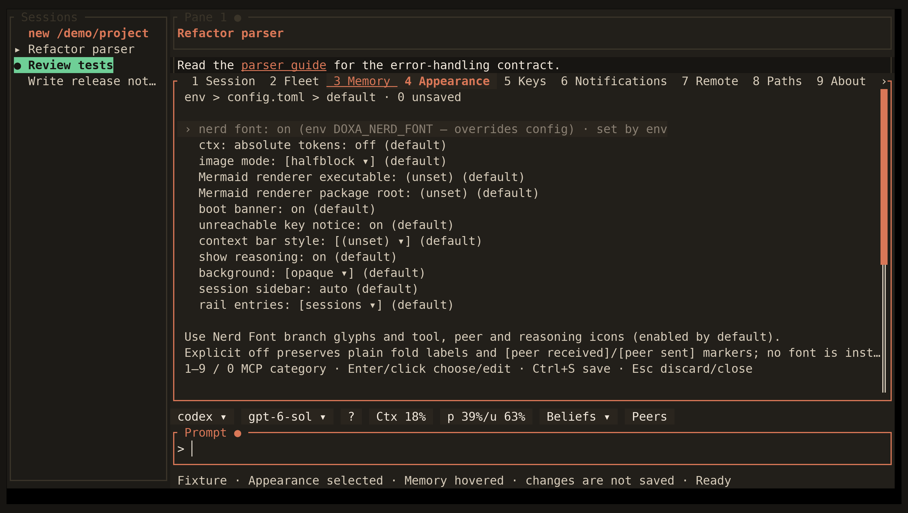

<!-- Generated by scripts/generate_gallery_pages.py from scenes.json. -->
# Settings

[← Queued prompts](./queued-prompts.md) · [Next: MCP and search settings →](./settings-mcp.md)

**Scene 13 of 28**

Settings categories appear on the submenu title bar; changes remain unsaved.

[Open the interactive gallery](https://docwilde.github.io/doxa/gallery/#settings) · [Back to the README gallery](../../../README.md#gallery)
