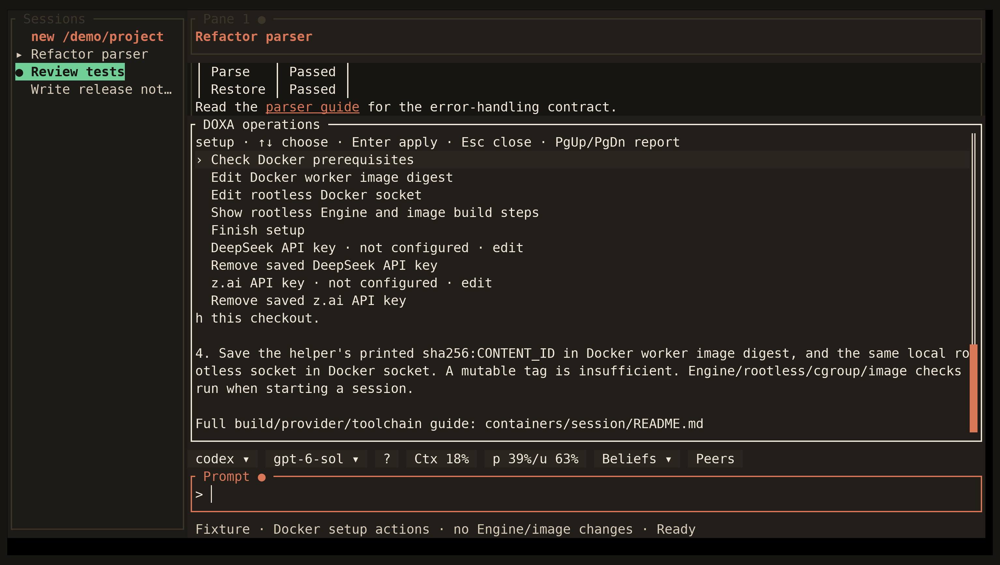

<!-- Generated by scripts/generate_gallery_pages.py from scenes.json. -->
# Docker setup

[← GLM reporting](./glm-account.md) · [Next: Project triage →](./triage.md)

**Scene 16 of 28**

Docker prerequisite, pinned image, and rootless socket setup controls appear without changing the host.

[Open the interactive gallery](https://docwilde.github.io/doxa/gallery/#setup-docker) · [Back to the README gallery](../../../README.md#gallery)
