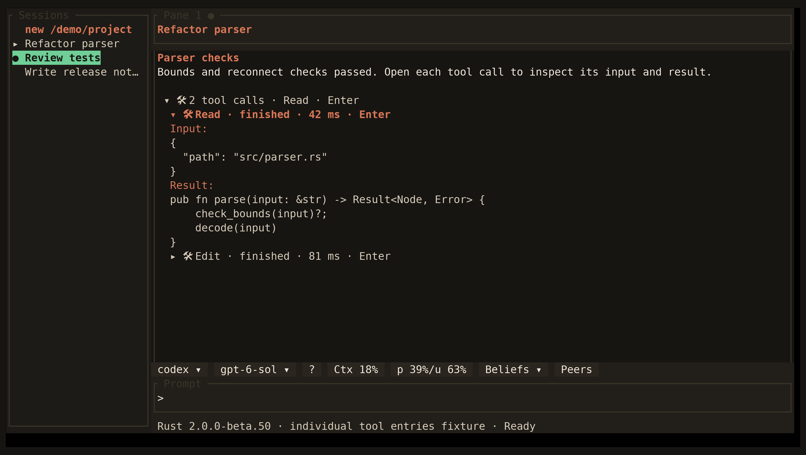

<!-- Generated by scripts/generate_gallery_pages.py from scenes.json. -->
# Tool details

[← Beliefs](./beliefs.md) · [Next: Memory →](./memory-management.md)

**Scene 23 of 28**

Expanded tool input and output use a synthetic event in the production renderer.

[Open the interactive gallery](https://docwilde.github.io/doxa/gallery/#tool-entries) · [Back to the README gallery](../../../README.md#gallery)
