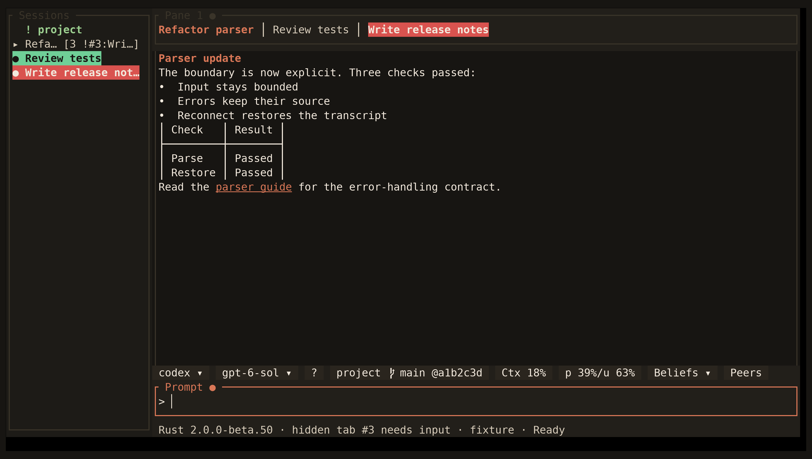

<!-- Generated by scripts/generate_gallery_pages.py from scenes.json. -->
# Project triage

[← Docker setup](./setup-docker.md) · [Next: Pane rail →](./pane-triage.md)

**Scene 17 of 28**

The project rail points to a hidden tab that needs input.

[Open the interactive gallery](https://docwilde.github.io/doxa/gallery/#triage) · [Back to the README gallery](../../../README.md#gallery)
