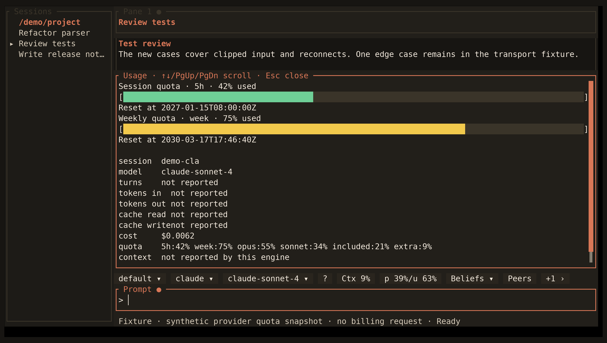

<!-- Generated by scripts/generate_gallery_pages.py from scenes.json. -->
# Subscription quota

[← Context usage](./context.md) · [Next: Peer messages →](./peer-messages.md)

**Scene 9 of 28**

Synthetic session and weekly quota snapshots include reset times and extra provider windows; no billing request is made.

[Open the interactive gallery](https://docwilde.github.io/doxa/gallery/#usage-quota) · [Back to the README gallery](../../../README.md#gallery)
