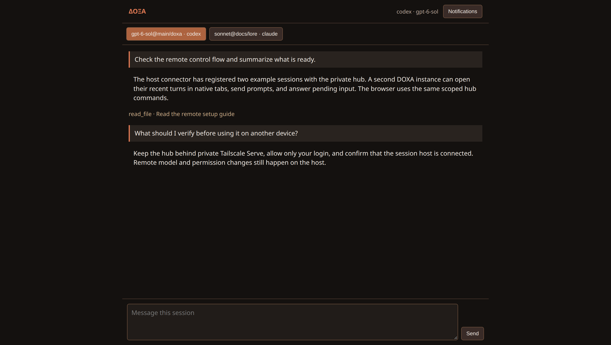
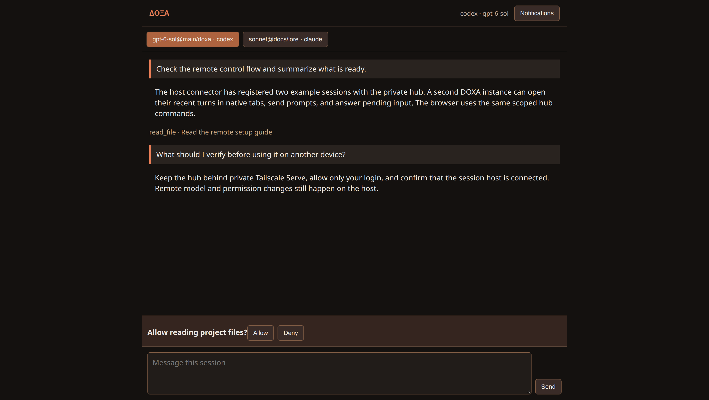
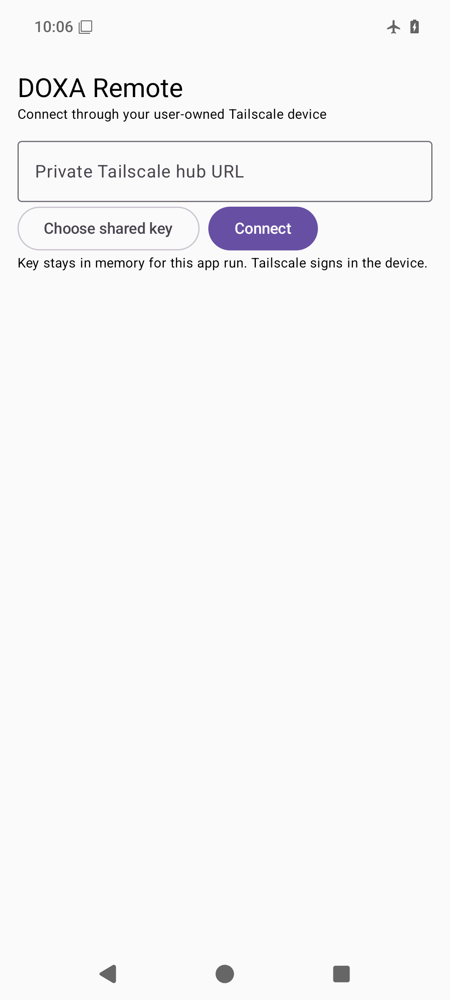

# Browser and Android gallery

These client views are separate from the [current terminal gallery](rust-gallery.md). Their capture records distinguish local examples from authenticated remote sessions.

## Browser





These **3068 × 1734** captures show the shipped `rust/doxa-remote/assets` in Chromium with isolated API fixtures. The browser UI did not change in beta.46. The examples exercise conversation and permission-review layout; authenticated hub and remote transport verification is recorded separately in the [remote hub plan](plans/remote-hub.md).

To reproduce them with Google Chrome and Node.js 22+:

```sh
export TMPDIR=/path/on/real/disk
python3 scripts/capture_remote_gallery.py
```

The script serves local assets on `127.0.0.1`, keeps temporary Chrome profiles under `~/.cache/doxa`, and writes the two browser PNGs to `assets/shots`.

## Android



This historical **beta.30** image shows the Android connection screen in a clean offline emulator. It documents the client layout and offline launch. Provisioned FCM, physical-device and two-host tailnet checks remain open. See the [Android client guide](../android-client/README.md) for setup and build instructions.
